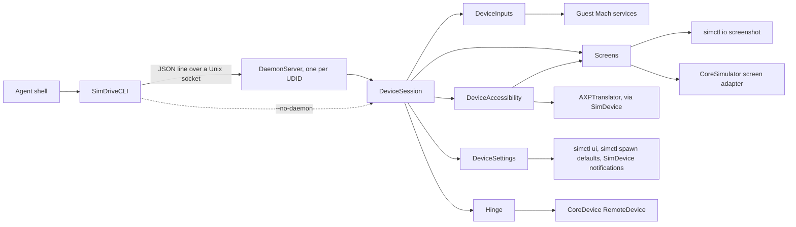

# Architecture

## Modules

Each module uses only the one below it.

| Module | Role |
| --- | --- |
| `simdrive` | The executable; calls `SimDriveCLI.run`. |
| `SimDriveCore` | Command parsing, the per-device session, screen geometry, settings, the daemon and its client. |
| `SimDriveNative` | Drivers for CoreSimulator, the guest's Mach services, CoreDevice and AccessibilityPlatformTranslation. Its API is `package`, so nothing private-framework-shaped leaks out of the package. |

Native types speak in domain terms (`tap(at:target:)`, `set(_ posture:)`), and Core never sees an XPC object, a Swift mangled name or an Objective-C selector. Native files named `Guest*` reach the guest's Mach services directly; `CoreDevice*` files go through CoreDevice.

## Request path

1. `SimDriveCLI` resolves the developer directory and the UDID (`booted` means the only booted simulator), parses the command, and sends the raw arguments to the device's daemon, starting it if needed.
2. `run` steps from a file or standard input are inlined as `--json` first, since the daemon shares neither the client's directory nor its input. Relative paths resolve against the client's working directory, which every request carries.
3. `DaemonServer` handles one request at a time. The main actor would otherwise interleave two requests' awaits, and the guest's input services expect their messages in order.
4. `DeviceSession.execute` dispatches the command to a helper and returns its JSON. The CLI prints one line, `{"ok":true,"result":…}` or `{"ok":false,"error":…,"code":…}`.

## Daemon lifecycle

- Spawned with `posix_spawn` in its own session (`POSIX_SPAWN_SETSID`), so it outlives the client and its terminal. Its output goes to `<udid>.log`.
- Each request carries `BuildStamp` (the executable's modification time) and the developer directory. A daemon that differs refuses with `stale-daemon` and exits; the client waits for its socket to go and retries once.
- Exits after 10 idle minutes, on `stop`, or on SIGTERM, SIGINT or SIGHUP, releasing its input services first.
- A `guest-connection` error releases every input, since a dead guest connection never recovers; the next command reconnects.

## State files

All live in `/tmp/simdrive-<uid>/`, mode 0700. `$TMPDIR` is not used: a Unix socket path is limited to 104 bytes, which `$TMPDIR` plus a UDID can exceed.

| File | Holds |
| --- | --- |
| `<udid>.sock` | The daemon's socket. |
| `<udid>.log` | The daemon's log. |
| `<udid>.screens.json` | The device's displays and each screen's last screenshot record, so one-shot runs and the daemon share calibration. Discarded when the boot date changes. |
| `<udid>.calibration.png` | The full-resolution screenshot taken when fractions need a screen size and none is recorded. |

## Capabilities

`DeviceSession` opens each capability through `LazyCapability` on first use. Opening returns nil when the device lacks it, which sticks; a throw is retried on the next use; a service that reports itself unusable (`hasFailed`) is reopened. Inputs also close after 30 s idle (see [design decisions](design-decisions.md#release-inputs-after-30-s)).

| Capability | Transport | Absent on |
| --- | --- | --- |
| Keyboard | Guest `remote.universalhidservice`: a main keyboard HID service, fed reports from UniversalHIDKit's `EventObserver` | — |
| Touches | Guest `remote.hid.digitizer` | tvOS (decided by runtime) |
| Buttons, Apple TV Remote | Guest `remote.hid.button`, consumer usage page | — |
| Orientation | Guest `remote.devicecontrol.orientation` | tvOS |
| Interface orientation | CoreSimulator's framebuffer screen adapter, in process | — |
| Pasteboard | CoreDevice `PasteboardCapability` | tvOS |
| Hinge | CoreDevice `MonitorMotionCapability` and `VendorDefinedHIDCapability` | All but the iPhone Duo |
| Accessibility | `AXPTranslator` on the Mac, requests carried by `SimDevice` | — |
| Screenshots, launch, `simctl ui` settings | CoreSimulator's own `simctl` binary | `simctl ui` on tvOS |
| Preference settings | `simctl spawn defaults`, then `SimDevice postDarwinNotification:error:` | — |

Guest services are reached the way CoreDevice's simulator plugin reaches them: `SimDevice lookup:error:` returns a Mach send right, which `xpc_endpoint_create_mach_port_4sim` and `xpc_connection_enable_sim2host_4sim` turn into an XPC connection. No CoreDevice record is needed. CoreDevice capabilities need the simulator's CoreDevice record, found by UDID in `DeviceManager.devices`, whose keys are not the UDID.

## Calling private Swift API

[ABIBridge](https://github.com/lynnswap/ABIBridge), pinned to 0.19.1, resolves Swift types, methods and getters by their demangled names at run time and calls them with a declared calling convention. Opaque values cross as `NativeSwiftValue`; `valueABIs` tell ABIBridge how to pass values it cannot lay out itself, such as `Data`-wrapping structs. Typed throws need a sample of the thrown error type, which `CoreDeviceRemote.errorSample()` supplies. Resolution happens when a driver opens, so a renamed method fails there, with the symbol in the message, rather than mid-command.

Objective-C private API (CoreSimulator, AXPTranslator) goes through `NSSelectorFromString` and `method(for:)` cast to a `@convention(c)` function type. Key-value coding works on local objects but not on CoreSimulator's remote proxies (see [private APIs](private-apis.md#interface-orientation)).

## Release

Tags `v0.0.1` and `v0.0.2` on GitHub. The package's only product is the `simdrive` executable; consumers run it with `swift run simdrive`. Exposing `SimDriveCore` as a library would freeze an API that changes with each Xcode.
