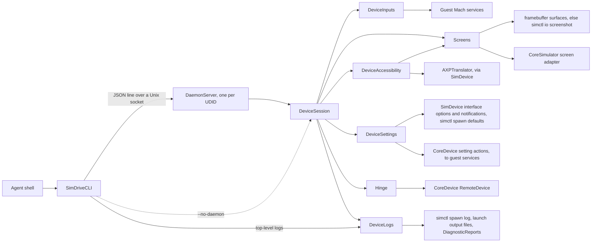

# Architecture

## Modules

Each module uses only the one below it.

| Module | Role |
| --- | --- |
| `simdrive` | The executable; calls `SimDriveCLI.run`. |
| `SimDriveCore` | Command parsing, the per-device session, screen geometry, settings, device logs, the daemon and its client. |
| `SimDriveNative` | Drivers for CoreSimulator, the guest's Mach services, CoreDevice and AccessibilityPlatformTranslation. Its API is `package`, so nothing private-framework-shaped leaks out of the package. |

Native types speak in domain terms (`tap(at:target:)`, `set(_ posture:)`), and Core never sees an XPC object, a Swift mangled name or an Objective-C selector. Native files named `Guest*` reach the guest's Mach services directly; `CoreDevice*` files go through CoreDevice.

## Source layout

Folders group code by subject; a subject usually has a driver in Native and a type of the same subject in Core that adds logic around it.

| Folder | Holds |
| --- | --- |
| `SimDriveNative/Simulator` | `SimulatorDevice`, CoreSimulator's `SimDevice`: state, boot date, screen scale, service lookup, Darwin notifications and the accessibility request channel. Framebuffer reads (`ScreenFramebuffers`, `ScreenAdapter`) and `InterfaceOrientation`. |
| `SimDriveNative/Guest` | `SimulatorGuest` and `GuestConnection`, XPC connections to the guest's Mach services; `GuestMessageCodec`, which encodes their messages as CoreDevice does; `GuestInputTiming`. |
| `SimDriveNative/Input` | `GuestKeyboard`, `GuestTouchscreen`, `GuestButtons`, `KeyboardBindings`, which turns Mac key events into HID reports, and `KeyboardLayout`, the guest's hardware keyboard layout. |
| `SimDriveNative/DeviceControl` | `GuestOrientation`, `GuestSettingActions`, `CoreDevicePasteboard`, `CoreDeviceHinge`. |
| `SimDriveNative/CoreDevice` | `CoreDeviceManager` and `CoreDeviceRemote`: finding the simulator's CoreDevice record and calling its capabilities. |
| `SimDriveNative/Accessibility` | `SimulatorAccessibility`, which drives `AXPTranslator`, and `AccessibilityElement`, the snapshot it returns. |
| `SimDriveNative/Support` | `SimDriveError` and `ErrorCode`, `SharedInitialization`, `waitForCompletion`, ABIBridge setup. |
| `SimDriveCore/CLI` | `SimDriveCLI`, the entry point. |
| `SimDriveCore/Commands` | `Command`, `CommandParser`, `Steps` (for `run`) and `CommandResults`, every result's JSON. |
| `SimDriveCore/Daemon` | `DaemonServer`, `DaemonClient`, the wire types in `DaemonProtocol`, `UnixSocket`, `StatePaths`. |
| `SimDriveCore/Session` | `DeviceSession` and `LazyCapability`. |
| `SimDriveCore/Input` | `DeviceInputs`, which owns the three input drivers, and `KeyMap`, characters and key names to key codes, on US or a `KeyboardLayout`. |
| `SimDriveCore/Screens` | `Screens`, `Screen`, `ScreenMapping`, `ScreenStore`, `Screenshots`, `SimulatorDisplay`: which display a point means and where it lands. |
| `SimDriveCore/Accessibility` | `DeviceAccessibility` and `AccessibilityLayout`: the tree in the fractions `tap` takes. |
| `SimDriveCore/Split` | `SplitView`, `SplitGesture` and `DisplayLayout`, the Duo's split view and the layout SpringBoard logs; `SplitState`, the half simdrive set, kept per app pid since reading SpringBoard's log for it takes seconds. |
| `SimDriveCore/DeviceControl` | `Hinge`, which waits for the hinge to settle at a posture. |
| `SimDriveCore/Settings` | `SettingCatalog` (one row per setting), `DeviceSettings`, `GuestPreferences`, and `CoreDeviceSetting`, which maps rows to setting actions' JSON. |
| `SimDriveCore/Logs` | `DeviceLogs`, `LogQuery`, `LogDigest`, `LogStore`, `LogEvent`, `CrashReports`. |
| `SimDriveCore/Tools` | `DeveloperTools`, which runs `simctl` and friends for one developer directory, and `BootedSimulators`. |
| `SimDriveCore/Support` | Core's `ErrorCode` constants and `JSONValue`. |

## Request path

1. `SimDriveCLI` resolves the developer directory and the UDID (`booted` means the only booted simulator), parses the command, and sends the raw arguments to the device's daemon, starting it if needed.
2. `run` steps from a file or standard input are inlined as `--json` first, since the daemon shares neither the client's directory nor its input. Relative paths resolve against the client's working directory, which every request carries.
3. `DaemonServer` handles one request at a time. The main actor would otherwise interleave two requests' awaits, and the guest's input services expect their messages in order. A top-level `logs` therefore runs in the client's process, so `logs --until` can wait while other calls drive the device; inside `run`, it runs in the daemon.
4. `DeviceSession.execute` dispatches the command to a helper and returns its JSON. The CLI prints one line, `{"ok":true,"result":…}` or `{"ok":false,"error":…,"code":…}`.

### Following a tap

`simdrive <udid> tap 0.5 0.3`:

1. `CommandParser` turns the arguments into `Command.tap(.normalized(CGPoint(x: 0.5, y: 0.3)), display: .automatic)`; whole numbers would be pixels of the last screenshot.
2. `DeviceSession.tap` asks `Screens.touchscreen` for the `Screen` the point refers to. `Screens` picks the display: on a Duo, the hinge says whether the cover or inner panel is in use. It then finds that display's last screenshot record in `ScreenStore`, or takes a calibration screenshot when none matches the current orientation.
3. `Screen.digitizerPoint` converts the fraction, which follows the interface's rotation as screenshots do, into the digitizer's unit coordinates, which follow the panel's native orientation (`ScreenMapping`).
4. `DeviceInputs.tap` opens `GuestTouchscreen` through its `LazyCapability` if needed, which opens a `GuestConnection` to the guest's digitizer service. The touchscreen posts a touch-down and a touch-up, encoded by `GuestMessageCodec`, then flushes the connection.
5. `DeviceInputs` starts its 30 s idle timer again, and the session returns the display and point as JSON.

### Following a tree

`simdrive <udid> tree`:

1. `DeviceAccessibility.tree` gets the `Screen`, as a tap does, and a snapshot from `SimulatorAccessibility`.
2. `SimulatorAccessibility` asks `AXPTranslator` for the frontmost app and its hierarchy. The translator calls back into `AccessibilityBridge`, which sends each request to the guest through `SimulatorDevice`'s `AccessibilityChannel` and returns the reply. Reads retry until one deadline (`Limit.read`).
3. `AccessibilityElement` decodes the snapshot: labels, traits, frames and children.
4. `AccessibilityLayout` converts the app's point frames into screenshot fractions, accounting for rotation and, on a Duo, a split app's offset. Light trees keep VoiceOver's elements and give each a tap point.

## Daemon lifecycle

- Spawned with `posix_spawn` in its own session (`POSIX_SPAWN_SETSID`), so it outlives the client and its terminal. Its output goes to `<udid>.log`.
- Each request carries `BuildStamp` (the executable's modification time) and the developer directory. A daemon that differs refuses with `stale-daemon` and exits; the client waits for its socket to go and retries once.
- Exits after 10 idle minutes, on `stop`, or on SIGTERM, SIGINT or SIGHUP, releasing its input services first; it waits at most 3 s for them, since a guest that stopped answering cannot be released. `stop` is answered at once, ahead of the request queue, so a stuck request cannot keep the daemon alive; that request's client gets `daemon-ended`.
- While a request runs or waits its turn, a dispatch source watches its client's socket. When the client goes away, as after Ctrl-C or its own timeout, the request's task is cancelled: a queued request is skipped, and a running one stops at its next sleep or wait. The client itself reads the reply without a limit, since `run` and `install` legitimately take minutes; `stop` and cancellation cover a stuck daemon.
- A `guest-connection` error releases every input, since a dead guest connection never recovers; the next command reconnects.

## State files

All live in `/tmp/simdrive-<uid>/`, mode 0700. `$TMPDIR` is not used: a Unix socket path is limited to 104 bytes, which `$TMPDIR` plus a UDID can exceed. Since any user can create that name in `/tmp`, `StatePaths.prepare` refuses, with `state-directory`, a directory that is a symlink or belongs to another user, and makes its own private if it is not. The client checks it before connecting to a socket there, and the daemon's log is opened without following symlinks.

| File | Holds |
| --- | --- |
| `<udid>.sock` | The daemon's socket. |
| `<udid>.log` | The daemon's log. |
| `<udid>.daemon.lock` | Locked by the device's daemon for its whole life, so a second daemon started by a concurrent client exits before it touches the socket. |
| `<udid>.screens.json` | The device's displays and each screen's last screenshot record, so one-shot runs and the daemon share calibration. Discarded when the boot date changes. |
| `<udid>.calibration.png` | The full-resolution screenshot taken when fractions need a screen size, none is recorded and the framebuffer cannot be read. |
| `<udid>.logs.json` | The app `launch` last started (bundle ID, pid, launch time, executable, output files) and each log cursor's position. `launch` replaces it. The command line and the daemon both write it, each under `<udid>.logs.json.lock`, and a write read before the latest `launch` is dropped. |

The launched app's stdout and stderr go to `simdrive.stdout.txt` and `simdrive.stderr.txt` in the device's own `tmp` directory, under its data path, since the guest resolves `simctl launch`'s paths in its filesystem.

## Capabilities

`DeviceSession` opens each capability through `LazyCapability` on first use. Opening returns nil when the device lacks it, which sticks; a throw is retried on the next use; a service that reports itself unusable (`hasFailed`) is reopened. Inputs also close after 30 s idle (see [design decisions](design-decisions.md#release-inputs-after-30-s)).

| Capability | Transport | Absent on |
| --- | --- | --- |
| Keyboard | Guest `remote.universalhidservice`: a main keyboard HID service, fed reports from UniversalHIDKit's `EventObserver` | — |
| Touches | Guest `remote.hid.digitizer` | tvOS (decided by runtime) |
| Buttons, Apple TV Remote | Guest `remote.universalhidservice`: a main-screen buttons HID service, sent consumer-page `CustomButtonReport`s; `--legacy` uses `remote.hid.button` | — |
| Orientation | Guest `remote.devicecontrol.orientation` | tvOS |
| Interface orientation | CoreSimulator's framebuffer screen adapter, in process | — |
| Screenshots | CoreSimulator's framebuffer surfaces, in process, else `simctl` | — |
| Pasteboard | CoreDevice `PasteboardCapability` | tvOS |
| Hinge | CoreDevice `MonitorMotionCapability` and `VendorDefinedHIDCapability` | All but the iPhone Duo |
| Accessibility | `AXPTranslator` on the Mac, requests carried by `SimDevice` | — |
| Launch | CoreSimulator's own `simctl` binary | — |
| Appearance, text size, contrast | `SimDevice` interface options, in process | tvOS |
| Preference settings | `simctl spawn defaults`, then `SimDevice postDarwinNotification:error:` | — |
| VoiceOver, color filter | CoreDevice setting actions sent to the guest service each names (`GuestSettingActions`) | Color filter changes before iOS 27; tvOS unverified |
| Logs | `simctl spawn log show` and `log stream`, files from `simctl launch --stdout --stderr`, and `~/Library/Logs/DiagnosticReports` | — |

Guest services are reached the way CoreDevice's simulator plugin reaches them: `SimDevice lookup:error:` returns a Mach send right, which `xpc_endpoint_create_mach_port_4sim` and `xpc_connection_enable_sim2host_4sim` turn into an XPC connection. No CoreDevice record is needed. CoreDevice capabilities need the simulator's CoreDevice record, found by UDID in `DeviceManager.devices`, whose keys are not the UDID.

## Key types

- **`Command`** is every command with its parsed arguments; `CommandParser` builds it and holds the usage text. Commands are values, so the parser is tested without a simulator.
- **`DeviceSession`** owns one booted device's capabilities and runs commands against them. It is the only Core type that sees every capability; the others each own one subject.
- **`LazyCapability<Service>`** opens a driver on first use and keeps it: nil means the device lacks it, for good; a throw is retried next time; `isUsable` reopens a failed one. Callers that arrive while it opens share that open.
- **`DeviceInputs`** owns the keyboard, touchscreen and buttons, and releases all three after 30 s idle. Each input holds an **`IdleRelease`** while it runs, so the release never closes a service mid-input.
- **`Screens`** knows the device's displays and each one's last screenshot; it returns a **`Screen`**, which maps that display's points to the digitizer through **`ScreenMapping`**. `ScreenStore` persists the screenshot records across processes.
- **`DeviceAccessibility`** places **`SimulatorAccessibility`**'s snapshots on the screen with **`AccessibilityLayout`**, and answers `becomesFrontmost` for `launch`.
- **`SimulatorDevice`** wraps CoreSimulator's `SimDevice`; **`SimulatorGuest`** opens a **`GuestConnection`** per guest service, and a connection that ends reports `hasFailed`.
- **`CoreDeviceRemote`** is the simulator's CoreDevice `RemoteDevice`, opened once per session and shared by the pasteboard and hinge.
- **`DeveloperTools`** runs `simctl` and other tools for the session's developer directory, and streams `log stream` lines.
- **`JSONValue`** is every result and the daemon's payload; results get their JSON in `CommandResults`, next to nothing else, so the README's JSON section has one place to check against.

## Errors

Every failure an agent can act on is a `SimDriveError`: an `ErrorCode`, the `code` field of the output, and a message that says what to do next. Native declares the codes its drivers throw as `package` constants in `SimDriveError.swift`; Core adds its own in `ErrorCodes.swift`. Any other error reaches the output with no `code`, so wrap failures an agent could handle. Error codes are API: agents branch on them, and the README and skill list them. A code declared with `retryable: true` adds `"retry": true` to the output, meaning the same command may succeed unchanged. `ErrorCodeDocumentationTests` fails when a code or its retry answer is missing from the README's error table.

## Concurrency

- Core's stateful types and the drivers are `@MainActor`; value types such as `Command` and `LogQuery` are `Sendable`. The daemon serves one request at a time, so a command's awaits never interleave with another's.
- `SimulatorAccessibility` runs translator calls on its own serial queue, since `AXPTranslator` calls its delegate synchronously and the delegate blocks until the guest replies.
- Every wait on something outside the process is bounded, since the daemon's queue waits behind it:
  - `SharedInitialization` gives CoreDevice's process-wide start one task that concurrent callers share, each waiting at most 30 s. A start that outlasts a caller is kept for the next caller rather than started again.
  - `CoreDeviceRemote.call` limits each capability call to 15 s and marks the record failed when one goes unanswered, so the session opens a new one.
  - `DeveloperTools` stops a tool after its limit, 60 s by default, 120 s for `log show` and 10 minutes for `install`, and fails with `tool-timeout`.
  - `waitForCompletion` and `withTimeLimit` bound the other waits on callbacks.
- Sleeps that hold an input, such as a touch or a key, use `pause`, which cannot throw, so the release is always sent.

## Tests and evaluation

- `Tests/SimDriveCoreTests` and `Tests/SimDriveNativeTests` cover pure logic: parsing, screen mapping and rotation, layout, gestures, log digests and queries, crash summaries, settings rows, snapshot decoding. They need no simulator; run them with `swift test`.
- `Evaluation/matrix.py <udid>` drives a real simulator end to end with a release build. On iPhones and iPads it installs the probe app (`Evaluation/Probe`, built by `build-probe.sh`), which logs the touches, keys, scene changes and trait changes it receives to a file the matrix reads. A command can return `ok` while the guest drops its input, so only the probe's log proves delivery. `--only <sections>` runs some sections; `--timing` measures common commands, and `SIMDRIVE=<path>` compares another build.
- [Testing](testing.md) lists what each section covers and the devices to run on.

## Where to start

- To add a command, follow "Adding a capability" in [AGENTS.md](../AGENTS.md): driver, session method, `Command` case and parser, JSON result, tests, docs.
- To add a setting, add a row to `SettingCatalog`.
- Before touching a private API, read [private APIs](private-apis.md) for how each one was found, and [device behavior](device-behavior.md) for what the guest does that the API does not say.
- [Design decisions](design-decisions.md) explains choices that look odd at first, such as the daemon and the 30 s input release; [open questions](open-questions.md) and the [backlog](../roadmap/backlog.md) list what is unknown or planned.

## Calling private Swift API

[ABIBridge](https://github.com/lynnswap/ABIBridge), pinned to 0.20.4, resolves Swift types, methods and getters by their demangled names at run time and calls them with a declared calling convention. Opaque values cross as `NativeSwiftValue`; `valueABIs` tell ABIBridge how to pass values it cannot lay out itself, such as `Data`-wrapping structs. Typed throws need a sample of the thrown error type, which `CoreDeviceRemote.errorSample()` supplies. Resolution happens when a driver opens, so a renamed method fails there, with the symbol in the message, rather than mid-command.

Objective-C private API (CoreSimulator, AXPTranslator) goes through `NSSelectorFromString` and `method(for:)` cast to a `@convention(c)` function type. Key-value coding works on local objects but not on CoreSimulator's remote proxies (see [private APIs](private-apis.md#interface-orientation)).

## Release

Tags `v0.0.1` to `v0.1.0` on GitHub. The package's only product is the `simdrive` executable; consumers run it with `swift run simdrive`. Exposing `SimDriveCore` as a library would freeze an API that changes with each Xcode.
